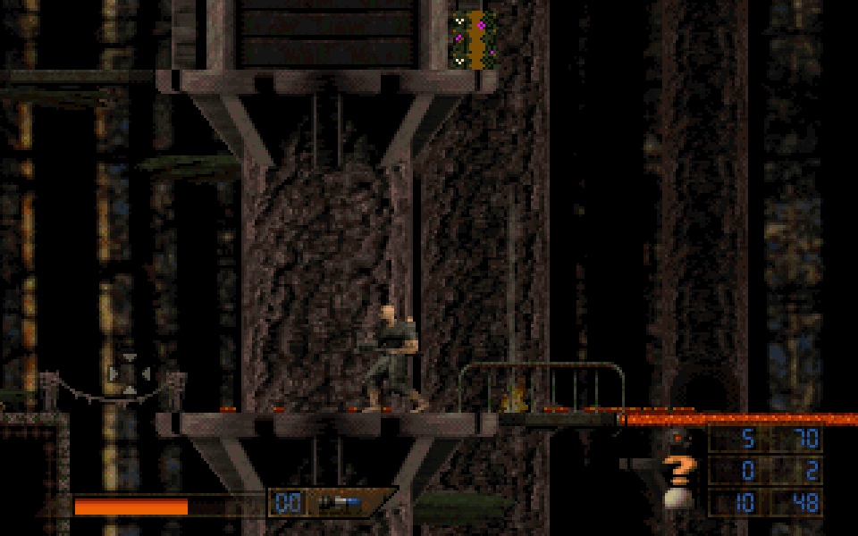

# 

[](https://mise.jdx.dev)




*Eat This* is a 1998 side-scrolling shooter for Windows 3.1/95 by Image-Line, written in Borland
Pascal 7. This repo reverse engineers it (Ghidra plus an x86 emulator that runs the original
EXE) and ports it to Rust + SDL2. It runs natively on a Mac, with no Windows and no VM.

The port aims to be exact, not merely look right. The game's recorded demos store its random
seed every 35 frames. The port replays each demo and has to match every one of those checks,
every `Random()` result, and the hero's position on every frame. New demos for features the CD
demos never show are recorded with the original game itself (`tools/mkdemo.py`).

## Progress

- **Simulation:** all 7 demos from the CD and 21 scenario demos match the original exactly,
  and every object type on the three episodes' maps is ported. Some smaller features are
  ported but untested; see [`re/unported.md`](re/unported.md).
- **Graphics:** tiles, sprites, parallax backgrounds, weather, the HUD and the message box.
- **Sound:** sound effects through an SDL2 mixer, and music from the CD's audio tracks. The
  port misses 3 of the original's 6,022 sound plays in the CD demos.
- **Front end:** the original's menus, episodes, the stats screen, the next level, saves and
  `EatThis.ini`. The videos play through an Indeo 3 decoder written for the port.
- **Not done:** the automap and a few smaller drawing details.

## Play

**Controls:** arrows to move and jump, the mouse to aim and fire (Insert/Space fire too), Tab or
1–0 to switch weapons, Esc for the menu.

**Extras** (Options > Extras, all off by default): game controllers, upscaling and CRT shaders, glow, widescreen, save
states (F8/F9, F10 for the slot), rewind (Backspace) and recordings. See [`docs/extras.md`](docs/extras.md).

## Build and run

You need your own copy of the original CD as a BIN/CUE image. The game's data is not in this
repo.

### mise

```bash
mise install                                                       # Rust, Python/uv, cmake, 7zip, Ghidra
cp "/path/to/Eat This.img" "/path/to/Eat This.cue" iso/
mise run extract                                                   # game data -> work/cd
python3 -I tools/extract_audio.py "iso/Eat This.cue" work/cd/AUDIO # music (optional)
mise run port                                                      # build and start at the menus
```

### plain Cargo

From `port/`:

```bash
cargo run --release -- --demo ../work/cd/BIN/USERMAPS/LEVEL1_2.DMO            # watch a demo
cargo run --release -- --map ../work/cd/BIN/MAPS/CITY01.MAP                   # play one map
cargo run --release -- --headless --demo ../work/cd/BIN/USERMAPS/LEVEL1_2.DMO # check it against the original
```

The reverse-engineering workflow (tracer, diffs, scenario demos) is documented in
[`AGENTS.md`](AGENTS.md). The notes on each subsystem are in [`re/`](re/), and
[`docs/handbook.md`](docs/handbook.md) is a handbook on the method, in Polish.

`port/src/frontend/indeo3.rs` is a port of FFmpeg's Indeo 3 decoder and is under LGPL-2.1.
